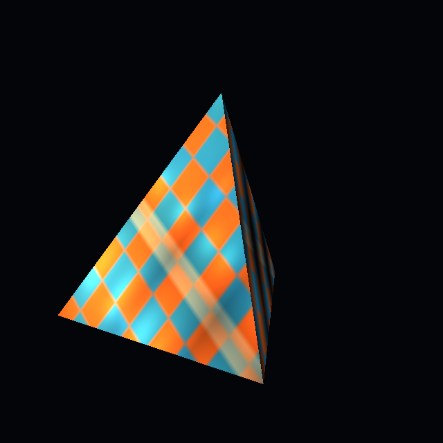

# Offline Asset Preview Renderer

A native Windows console application that renders OBJ assets with a CPU-only
soft-rasterization pipeline. It is intended for deterministic offline checks of
texture coordinates, tangent spaces, normal maps, clipping, and lighting. No GPU
API or third-party render engine is used.



## Build On Windows

Prerequisites:

- Visual Studio 2022 or Visual Studio Build Tools with the C++ desktop workload.
- CMake 3.20 or newer on `PATH`.
- Python 3 is optional and is used only by the integration tests.

From a Developer PowerShell or a shell where CMake can find MSVC:

```powershell
cmake -S . -B build -G "Visual Studio 17 2022" -A x64
cmake --build build --config Release
ctest --test-dir build -C Release --output-on-failure
```

The console executable is `build\Release\asset_preview.exe`. The deterministic
fixture generator is `build\Release\make_sample.exe`.

A verified MSVC/x64 release build is also packaged under
`artifacts/windows-x64/` with its compiler metadata and SHA-256 hashes.

## Run

```powershell
build\Release\asset_preview.exe configs\sample.json
```

The sample writes `out\sample.bmp`. The other checked-in configurations exercise
the geometry-normal fallback and explicit asset tangents:

```powershell
build\Release\asset_preview.exe configs\sample_no_normal.json
build\Release\asset_preview.exe configs\sample_tangents.json
```

Regenerate all deterministic test assets:

```powershell
build\Release\make_sample.exe assets
```

`asset_preview.exe` takes exactly one argument, the JSON configuration path.
Relative config paths are resolved against the config file's directory.

## Configuration

Required root fields are `width`, `height`, `obj_path`, `output_path`, `camera`,
and `lights`. Optional fields are `double_sided`, `ambient`, and `background`.

```json
{
  "width": 640,
  "height": 640,
  "obj_path": "../assets/tetra.obj",
  "output_path": "../out/sample.bmp",
  "double_sided": false,
  "ambient": [0.035, 0.04, 0.055],
  "background": [0.015, 0.02, 0.03],
  "camera": {
    "position": [3.2, 1.4, 4.8],
    "target": [0.0, -0.1, 0.0],
    "up": [0.0, 1.0, 0.0],
    "vertical_fov_degrees": 42.0,
    "near": 0.1,
    "far": 100.0
  },
  "lights": [
    {
      "type": "directional",
      "direction": [-0.45, -1.0, -0.55],
      "color": [1.0, 0.96, 0.88],
      "intensity": 0.75
    },
    {
      "type": "point",
      "position": [-1.8, 1.5, 2.4],
      "color": [1.0, 0.72, 0.45],
      "intensity": 2.2,
      "attenuation": {
        "constant": 1.0,
        "linear": 0.18,
        "quadratic": 0.08
      }
    }
  ]
}
```

Validation rules:

- `width` and `height` are positive integers up to 16384.
- `vertical_fov_degrees` must be greater than 0 and less than 180.
- `near` and `far` require `0 < near < far`.
- Camera `position` and `target` must differ. `up` must be nonzero and not
  parallel to the view direction.
- Light colors and ambient/background values are RGB arrays in `[0, 1]`.
- Light intensity is non-negative. Directional light directions are normalized.
- A point light's `attenuation.constant` must be positive; linear and quadratic
  terms must be non-negative. Missing attenuation values default to
  `constant=1, linear=0, quadratic=0`.
- JSON syntax errors, missing fields, duplicate keys, wrong types, non-finite
  numbers, and out-of-range values produce `E_CONFIG`.

## Asset Support

OBJ support:

- `v`, `vt`, `vn`, `f`, `usemtl`, and `mtllib`.
- Faces use `v/vt/vn` indices. Positive and negative OBJ indices are accepted.
- Polygonal faces are fan-triangulated.
- Positions, texture coordinates, and normals are required. A missing required
  attribute is treated as an invalid OBJ.
- The optional extension `vtangent x y z` associates a tangent with the most
  recently declared `v`. `tangent x y z` is accepted as an alias.

MTL support:

- `newmtl`, `map_Kd`, `norm`, `map_Bump`, `bump`, `Kd`, `Ks`, and `Ns`.
- `map_Kd` is required by the renderer. `norm` is optional.
- A missing normal-map field or missing normal-map file falls back to the
  interpolated geometric normal without failing the render.
- Diffuse and normal texture paths are resolved relative to the MTL directory,
  with the OBJ directory as a fallback.
- MTL map option flags such as `-o`, `-s`, and `-t` are not supported; the
  complete argument after the map keyword is treated as the path.

If an OBJ does not contain tangents, the renderer accumulates position/UV
derivatives per indexed vertex, applies Gram-Schmidt orthogonalization against
the vertex normal, and derives tangent handedness from the accumulated
bitangent. Zero-length supplied tangents, zero-UV-determinant triangles, and
degenerate tangent results use a stable orthonormal fallback basis.

## Rendering Pipeline

1. OBJ and MTL records are parsed and validated. Triangle material assignments
   survive fan triangulation.
2. `glm::lookAt` and `glm::perspective` produce the world-to-clip transform.
3. Each triangle is back-face culled from its geometric normal and camera
   direction unless `double_sided` is enabled.
4. Triangles are clipped against the near plane and all six frustum planes in
   homogeneous clip space. Clip results are fan-triangulated.
5. Screen-space bounding boxes are rasterized with edge functions. Attribute
   interpolation uses perspective-correct `1/w` weights.
6. The Z buffer stores interpolated inverse depth (`1/w`), so larger values are
   closer. A fragment updates color only after passing depth test.
7. Geometry normal, tangent, tangent sign, UV, and world position are
   interpolated. Tangent is re-orthogonalized against normal.
8. The normal map is bilinearly sampled with clamp-to-edge, decoded from
   `[0,1]` to `[-1,1]`, normalized, and transformed through the world-space
   tangent basis.
9. Blinn-Phong shading combines constant ambient light, directional lights, and
   attenuated point lights. The diffuse albedo affects diffuse and specular
   color; the perturbed normal affects both lighting terms.
10. The float framebuffer is clamped and written as a 24-bit BMP.

Textures use bilinear filtering and clamp-to-edge addressing. OBJ's lower-left
texture origin is respected by flipping the vertical sampling coordinate.

## BMP Output

The writer emits a 14-byte `BITMAPFILEHEADER` and a 40-byte
`BITMAPINFOHEADER`:

- 24 bits per pixel, one plane, `BI_RGB`.
- Positive height, so rows are bottom-up.
- BGR channel order.
- Each row is padded to a 4-byte boundary with zero bytes.
- Pixel data starts at offset 54.
- File size, `BI_SIZE`, and resolution metadata are filled explicitly.

Output parent directories are created when possible. Failure to create, open,
write, or flush the file returns `E_OUTPUT_WRITE`.

## Errors And Exit Codes

Every failure writes one diagnostic beginning with its business code to
`stderr`, for example:

```text
E_INDEX_INVALID: position index 999 is out of range on line 8
```

| Code | Exit | Meaning |
| --- | ---: | --- |
| `E_CONFIG` | 10 | Missing, malformed, or invalid JSON configuration |
| `E_OBJ_MISSING` | 11 | Missing/unreadable OBJ, malformed geometry, or missing required OBJ attribute |
| `E_INDEX_INVALID` | 12 | Zero or out-of-range OBJ face index |
| `E_MAT_MISSING` | 13 | Missing MTL, undefined material, missing diffuse map, or missing referenced diffuse file |
| `E_IMAGE_DECODE` | 14 | An existing PNG cannot be decoded |
| `E_OUTPUT_WRITE` | 15 | BMP directory/file creation or write failure |
| `E_USAGE` | 2 | Wrong command-line argument count |
| `E_INTERNAL` | 16 | Unexpected standard-library/runtime failure |

## Verification

The integration suite is `tests/validate.py`. It generates two independent
copies of the assets to check determinism, then validates:

- BMP signature, headers, row alignment, padding, dimensions, and pixel data.
- Meaningful foreground/background coverage and a variety of shaded colors.
- Normal-map output differs substantially from geometry-normal fallback.
- Explicit tangents and generated tangents produce effectively identical
  output.
- Missing normal-map file falls back without error.
- Zero-length supplied tangents and UV-degenerate triangles use the fallback
  tangent basis and still render.
- Near/frustum clipping renders successfully.
- A four-corner OBJ face is fan-triangulated and rendered.
- Every requested error category returns the expected `E_` code and nonzero
  process exit.

Recorded on 2026-11-17:

```text
Linux:   GCC 15.2.0, CMake 3.30.5
Windows: MSVC 19.29.30157.0 (VS 2019 Build Tools), CMake 3.20.21032501, x64

rendered_pixels                         102400
padded_bmp_row_stride                   972   (323-pixel-wide image)
normal_vs_fallback_abs_diff             503898
generated_vs_supplied_tangent_abs_diff  0
validated error codes                   E_CONFIG, E_OBJ_MISSING,
                                        E_INDEX_INVALID, E_MAT_MISSING,
                                        E_IMAGE_DECODE, E_OUTPUT_WRITE,
                                        E_USAGE
```

The 640x640 sample BMP byte hashes were identical between the GCC/Linux and
MSVC/x64 Windows builds:

```text
eb4ce9ba33d1076733b171b2e657b33dc4ff19855fb146e4b4cea03592a5c085  out/sample.bmp
9dff0d811f7603429b7aa223d751d137a7ccf61f96697b775c4ee557f49611ea  out/sample_no_normal.bmp
9c40bd7d3e6c1ee17bd8d5fc09abde432dbf2fd03a07df17742e0326f699af47  out/sample_tangents.bmp
```

For the 640x640 normal-mapped sample, 68,057 pixels were non-background,
26,530 distinct colors were produced, and the lit RGB channels averaged 134.28.
The final BMP was also converted to `docs/sample_preview.png` for visual review.

## Scope

- The only third-party code is stb_image 2.28 (PNG decode) and GLM 0.9.9.8.
- Texture sampling does not perform sRGB linearization, gamma correction, or
  mipmapping.
- There is no model transform field; OBJ coordinates are world coordinates.
- There is one output image per invocation and no animation support.
