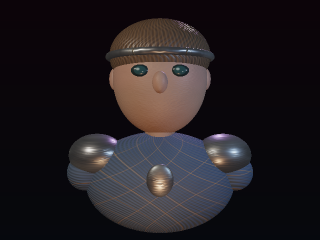

# Layered Character Renderer

Windows 控制台程序，面向角色多套外观的离线渲染。程序在本地生成固定种子样本，解析多层 PBR 材质，执行延迟着色，并维护可版本化、可回滚、可差异合并的点光源快照。



## 功能

- 五套角色材质（`skin`、`cloth`、`metal`、`hair`、`eyes`），共 13 个材质层、52 张 512x512 PNG。
- 每层包含 `baseColor`、`metallic`、`roughness`、`normal` 四张图和 `blendMode`、`opacity`。
- 640x480 离屏渲染，G-Buffer 保存基础色、金属度、粗糙度、世界空间法线、深度。
- 第二阶段逐点光源计算 GGX 镜面项与 Lambert 漫反射项。
- JSON 材质解析错误继续处理其他材质；纹理解码、快照、合并、权限错误分别输出独立业务码。
- 不可变光源快照、提交日志、原子当前状态、回滚、差异计算和原子合并。
- `--verify` 双次重渲染并与参考图逐通道比较，固定容差为 `1/255`。
- Windows 默认 OpenGL 4.3 延迟着色；无显示环境可使用确定性的 CPU 参考后端。

## Windows 构建

前置条件：

- Visual Studio 2022 或更高版本，安装“使用 C++ 的桌面开发”工作负载。
- 支持 OpenGL 4.3+ 的显卡驱动。
- CMake 3.24+。

安装 vcpkg 依赖：

```powershell
git clone https://github.com/microsoft/vcpkg.git C:\tools\vcpkg
C:\tools\vcpkg\bootstrap-vcpkg.bat
$env:VCPKG_ROOT = "C:\tools\vcpkg"
```

`vcpkg.json` 声明了 `glfw3`、`glm`、`stb`、`nlohmann-json`。构建：

```powershell
cmake --preset windows-vcpkg
cmake --build --preset windows-release
.\build\windows\Release\character_renderer.exe
```

也可直接用 Visual Studio 打开仓库，选择 `windows-vcpkg` preset。

## 运行

无参数时等价于 `--render`。第一次运行会在 `render_data/` 生成样本、初始快照并输出：

```text
render_data/output/render.png
render_data/output/reference_opengl.png
```

常用命令：

```powershell
character_renderer.exe --backend cpu --render
character_renderer.exe --backend cpu --verify
character_renderer.exe --list-materials
character_renderer.exe --list-lights
character_renderer.exe --create-snapshot
character_renderer.exe --list-snapshots
character_renderer.exe --rollback 3
character_renderer.exe --diff 2 5
character_renderer.exe --merge 2 5
character_renderer.exe --add-light extra 1,2,3 0.2,0.4,0.8 12 6
character_renderer.exe --update-light key intensity 40
character_renderer.exe --remove-light extra
character_renderer.exe --reset-lights
```

全局参数：

- `--data-dir PATH`：样本、快照和当前状态目录，默认 `render_data`。
- `--output-dir PATH`：图像目录，默认 `<data-dir>/output`。
- `--backend auto|cpu|opengl`：默认 `auto`。Windows 优先 OpenGL；上下文不可用时可回退 CPU 并输出警告。显式指定 `opengl` 时不会静默回退。
- `--force-regenerate`：删除并重建确定性样本，不改动快照。

Linux CPU 参考构建：

```bash
cmake -S . -B build/cpu -G "Unix Makefiles" \
  -DCMAKE_BUILD_TYPE=Release -DCHARACTER_RENDER_OPENGL=OFF
cmake --build build/cpu -j
tests/run_integration.sh ./build/cpu/character_renderer
```

## 材质格式

材质 JSON 位于 `<data-dir>/materials/`，按文件名字典序扫描。相对纹理路径从 JSON 所在目录解析。

```json
{
  "name": "skin",
  "layers": [
    {
      "name": "skin_base",
      "baseColor": "../textures/m0_l0_skin_base_basecolor.png",
      "metallic": "../textures/m0_l0_skin_base_metallic.png",
      "roughness": "../textures/m0_l0_skin_base_roughness.png",
      "normal": "../textures/m0_l0_skin_base_normal.png",
      "blendMode": "override",
      "opacity": 1.0
    }
  ]
}
```

层按数组顺序自底向上叠加。四张图均按 RGBA 读取；金属度、粗糙度取红通道，法线为切线空间 `[0,1]` 编码。第 `L` 层的混合权重 `w` 定义为：

- `override`：`w = opacity`
- `linear`：`w = opacity * baseColor.a`
- `mask`：`w = opacity * baseColor.a * luminance(baseColor.rgb)`

颜色、金属度、粗糙度执行 `mix(dst, src, w)`；切线法线执行向量混合后重新归一化，再通过几何切线与副切线变换到世界空间。

缺失纹理文件、非法 `blendMode`、非法 `opacity` 等会向 stderr 输出 `E_MAT_PARSE`，该材质被跳过，其余材质继续处理。若渲染需要的五套材质任一缺失，进程以非零码结束。

## 确定性

- 固定种子 `0x51A7C0DE9E3779B9`。
- 所有样本由程序程序化生成，不读取外部资源或网络。
- 材质文件排序、光源列表和快照差异均使用稳定顺序。
- 渲染无随机数、无时间输入、无多线程竞争。
- PNG 编码参数固定。
- `--verify` 连续渲染两次，逐通道差值必须不超过 1；再与 `reference_<backend>.png` 比较。
- 首次成功渲染自动创建参考图。参考图按后端区分；`--verify` 失败时不会覆盖参考图。

## 快照与恢复

目录布局：

```text
<data-dir>/
  snapshots/
    snapshot_000001.json
    commits.log
  state/
    current_lights.json
```

每个快照包含唯一递增版本号、UTC 时间戳和完整光源数组。`createSnapshot` 按以下顺序提交：

1. 写同目录临时文件并 `fsync`/`_commit`。
2. 原子替换为 `snapshot_XXXXXX.json`。
3. 追加提交记录（版本、文件名、时间戳、FNV-1a 64 位内容哈希）并再次持久化。

启动时只把提交日志中存在且哈希匹配的快照视为已提交。已重命名但未写提交标记的孤立快照不会恢复；下一版本号会避开其占用的编号。强制结束进程时，可恢复范围截止最后一个完整提交标记。回滚和差异操作只读取快照文件。

差异 JSON 包含：

- `added`：新增光源完整数据。
- `removed`：删除光源 id。
- `modified`：光源 id、变更字段、基线值、目标值。

合并会先对所有新增、删除、修改项做完整校验。修改项只比较发生变化的字段；任一被变更字段与基线不一致、新增 id 已存在、删除对象与基线不一致时，输出 `E_SNAPSHOT_CONFLICT`，当前场景完全不变。校验通过后才一次性应用并原子写当前状态。

## 错误码

所有业务错误均返回进程退出码 `1`，业务码只输出到 stderr，不作为进程退出码。

| 业务码 | 场景 |
| --- | --- |
| `E_MAT_PARSE` | 材质 JSON 非法、纹理路径缺失、非法 `blendMode`/`opacity`，可继续处理其他材质 |
| `E_TEX_LOAD` | 纹理存在但 PNG 解码失败 |
| `E_SNAPSHOT_NOT_FOUND` | 回滚/显示/差异/合并引用了未提交或不存在版本 |
| `E_SNAPSHOT_CONFLICT` | 差异合并与当前场景冲突 |
| `E_IO_DENIED` | 文件或目录权限不足 |
| `E_RENDER_NONDETERMINISTIC` | 双次渲染不一致，或与参考图超过 `1/255` |

另有 `E_OPENGL_UNAVAILABLE`、`E_OPENGL`、`E_DATA_INVALID`、`E_IO` 用于后端或输入诊断。

## OpenGL 管线

OpenGL 4.3 core 路径使用隐藏 GLFW 窗口和离屏 FBO，不依赖默认帧缓冲：

- G-Buffer attachment 0：`RGBA8` 基础色 + 金属度。
- G-Buffer attachment 1：`RGBA16F` 世界空间法线 + 命中标记。
- G-Buffer attachment 2：`R32F` 粗糙度。
- G-Buffer attachment 3：`R32F` 线性深度。
- 另附 24 位深度 renderbuffer。
- 第一阶段对程序化角色 SDF 求交，按命中材质在着色器中用纹理数组完成多层混合。
- 第二阶段全屏 pass 逐光源执行 GGX + Lambert，再做固定色调映射与 gamma 编码。
- OpenGL 单帧最多 64 个活动点光源；CPU 后端不设该上限。

CPU 后端保留同样的“材质合成/G-Buffer — 光照”两阶段结构，用于无显示环境的验收与基准输出。

## 测试

```powershell
ctest --test-dir build\windows -C Release --output-on-failure
# 或
.\tests\run_integration.ps1 .\build\windows\Release\character_renderer.exe
```

```bash
ctest --test-dir build/cpu --output-on-failure
# 当前环境没有 ctest 时：
tests/run_integration.sh ./build/cpu/character_renderer
```

集成脚本覆盖渲染、连续 `--verify`、快照回滚、差异、冲突原子性、新增/删除差异、`E_MAT_PARSE` 继续处理、`E_TEX_LOAD`、`E_IO_DENIED`、孤立快照忽略、状态恢复和 `E_RENDER_NONDETERMINISTIC`。

本机实际验证数据与哈希见 [VALIDATION.md](VALIDATION.md)。

