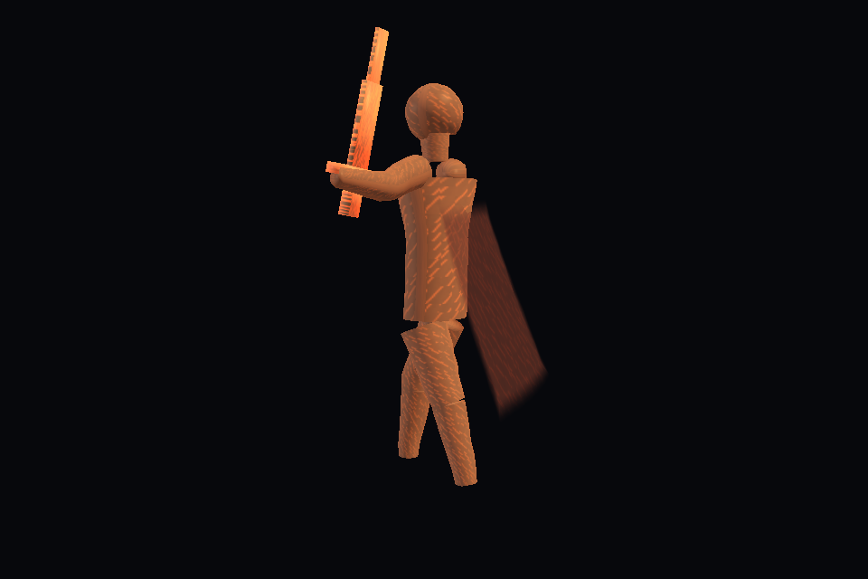

# 分层骨骼角色渲染器

从空工作区实现的 Windows/OpenGL 3.3 第三人称角色渲染模块。角色、骨骼、蒙皮权重、装备贴图和披风全部由固定种子程序化生成，不需要外部模型或图片。



## 已实现能力

- 固定 60 Hz 逻辑步进，渲染帧率可变，渲染姿态在相邻逻辑姿态之间做平移插值 + 四元数 slerp。
- 22 根骨骼的层级骨架，包含躯干、头部、双臂、双腿、武器挂点和三节披风骨。
- 8 个独立网格：Torso、Head、LeftArm、RightArm、LeftLeg、RightLeg、Weapon、Cape。
- SplitMix64 确定性随机数生成器、自描述规范化字节序列化和 FNV-1a 数据哈希。
- 每顶点最多 4 骨权重；权重和、骨骼索引、三角形索引在启动时强制验证。
- 两套装备 `iron` / `ember`，包含程序生成 RGBA 贴图、材质参数和不同自发光颜色/强度。
- 单 OpenGL 着色器程序同时处理主光、补光和自发光；装备切换只绑定另一组预上传纹理并更新 uniform。
- 披风逐三角形按当前蒙皮姿态和相机距离从远到近排序，使用不写深度的 alpha 混合和 UV 边缘 smoothstep 柔化。
- 结构化 stderr 错误、稳定错误码和非零进程退出码。
- 确定性 JSON 帧统计、插值误差、披风遮挡统计与最终状态快照。

## Windows 构建

环境：

- Windows 10/11 x64
- Visual Studio 2022，含“使用 C++ 的桌面开发”
- CMake 3.20+
- vcpkg

依赖由 [vcpkg.json](vcpkg.json) 的 manifest 自动安装，基线和版本已固定：

- `glfw3`
- `glm`
- `glad`，功能 `gl-api-33`

准备 vcpkg：

```bat
git clone https://github.com/microsoft/vcpkg.git C:\dev\vcpkg
C:\dev\vcpkg\bootstrap-vcpkg.bat
set VCPKG_ROOT=C:\dev\vcpkg
```

构建并运行测试：

```bat
build_windows.bat
```

该脚本执行：

```bat
cmake --preset windows-vcpkg
cmake --build --preset windows-release
ctest --preset windows-tests
```

产物：

- `build\windows\Release\character_demo.exe`
- `build\windows\Release\character_headless.exe`

也可以直接使用 Visual Studio 2022 打开 `build\windows\LayeredCharacterRenderer.sln`。

## 运行

启动实时窗口：

```bat
run_demo.bat
```

或直接执行：

```bat
build\windows\Release\character_demo.exe --seed 1337 --equipment iron --switch-time 1.25 --report reports\window-report.json --snapshot reports\window-snapshot.json
```

窗口操作：

- `E`：立即切换装备，姿态不跳变。
- 按住鼠标左键拖动：环绕相机。
- 滚轮：缩放。
- `R`：重置相机。
- `C` / `Esc`：退出并写报告。

确定性无头运行：

```bat
run_validation.bat
```

或：

```bat
build\windows\Release\character_headless.exe --headless --seed 1337 --logic-frames 360 --render-fps 120 --max-render-frames 720 --switch-time 1.25 --equipment iron --report reports\validation-report.json --snapshot reports\state-snapshot.json
```

## 命令行参数

| 参数 | 说明 |
| --- | --- |
| `--seed N` | 骨骼、骨骼抖动、蒙皮权重、贴图、动画相位的种子，默认 `1337` |
| `--logic-frames N` | 固定 60 Hz 逻辑步数，默认 `240` |
| `--render-fps F` | 无头帧调度和统计；窗口程序不锁帧，默认 `120` |
| `--max-render-frames N` | 渲染帧上限；`0` 表示按逻辑时长完整运行 |
| `--switch-time T[,T...]` | 在指定逻辑时刻切换装备；多个时刻会依次切换 |
| `--equipment iron\|ember` | 初始装备，默认 `iron` |
| `--texture-size N` | 程序化贴图边长，2 的幂，默认 `128` |
| `--report PATH` | 验证报告 JSON |
| `--snapshot PATH` | 最终状态快照 JSON |
| `--fault none\|texture\|shader\|bone` | 确定性故障注入 |
| `--width/--height` | 窗口尺寸 |
| `--headless` | 仅由 `character_headless` 使用 |

窗口程序只有在显式传入 `--logic-frames` 时才在该逻辑步数后退出；未传入时持续运行直到窗口关闭。无头程序始终执行指定逻辑帧数。

## 错误码

错误以单行 JSON 写到 stderr，并以对应非零整数退出：

| 错误码 | 数值 | 场景 |
| --- | ---: | --- |
| `E_INVALID_ARGUMENT` | 10 | 参数非法 |
| `E_TEXTURE_GENERATION` | 20 | 程序化贴图生成/校验失败 |
| `E_SHADER_COMPILE` | 30 | GLSL 编译失败，包含编译器日志 |
| `E_SHADER_LINK` | 31 | 着色器程序链接失败 |
| `E_BONE_INDEX` | 40 | 骨骼索引或父骨骼索引越界 |
| `E_GPU_INIT` | 50 | GLFW/GLAD/OpenGL 资源初始化失败 |
| `E_IO` | 60 | 报告、快照或图像写入失败 |
| `E_INTERNAL_INVARIANT` | 70 | 不可恢复的内部不变量失败 |

示例：

```json
{"error":{"code":"E_BONE_INDEX","exit_code":40,"stage":"character.validate","message":"bone index out of range in part Torso"}}
```

## 本地验证

Linux/WSL 下无需 OpenGL 窗口即可运行核心测试和确定性回归：

```bash
bash scripts/validate_local.sh
```

脚本会：

1. 构建 `lcr_core`、`character_headless` 和 `character_tests`。
2. 检查同 seed 骨骼/网格逐字节一致、不同 seed 不同。
3. 检查贴图确定性和故障码。
4. 检查装备切换前后姿态哈希与关节点最大误差为 0。
5. 对比 45/144 FPS 下插值前后的关节点误差。
6. 检查披风三角形排序、躯干遮挡、武器遮挡和边缘 alpha。
7. 以 120 FPS 和 45 FPS 运行同一仿真，比较最终快照字节。
8. 分别检查退出码 20/30/40 和 stderr JSON。

可选 OSMesa 离屏真实渲染验证（Linux）：

```bash
cmake -S . -B build/offscreen \
  -DLCR_BUILD_OFFSCREEN=ON \
  -DLCR_BUILD_TESTS=OFF
cmake --build build/offscreen -j
./build/offscreen/character_offscreen \
  --seed 1337 --width 960 --height 640 \
  --report build/offscreen/reports/offscreen-report.json
```

该工具真实创建 OpenGL 3.3 上下文、编译 GLSL、渲染两套装备并回读像素。系统需要 OSMesa 8+ 开发包。

## 实际验证结果

本工作区的最终结果记录在 [docs/VALIDATION.md](docs/VALIDATION.md)：

- 同 seed 数据哈希：skeleton `0b6bd8ea0b650af1`，mesh `6495698dc1fc5c8e`，character `743d69a03bfed51b`。
- 45 FPS：最大关节点误差从 `7.72096403e-3` 降到 `3.46708111e-4`，降低约 22.3 倍。
- 144 FPS：最大关节点误差从 `1.06138391e-2` 降到 `4.33905952e-4`，降低约 24.5 倍。
- 装备切换：前后姿态哈希均为 `258d224406ccb7e0`，最大关节点位置差 `0`。
- 披风：768 三角形排序违例 `0`；样本同时包含躯干遮挡 272 个和武器遮挡 189 个三角形。
- OSMesa/llvmpipe 实际渲染：960×640，44,284 个角色像素，装备切换产生 44,643 个可见像素差异，shader build 1 次、VAO 8 次、纹理上传 4 次、装备切换管线重建 0 次。
- 三次故障注入均按 20/30/40 退出；真实 Mesa GLSL 编译失败也按 30 退出并输出编译器日志。

## 目录

```text
src/core/       确定性骨骼、网格、动画、装备、披风排序、报告
src/render/     OpenGL 3.3 渲染器、着色器、GPU 资源
src/headless_main.cpp  无窗口确定性命令行程序
tools/         可选 OSMesa 离屏验证器
tests/         核心确定性测试
validation/    本工作区实际生成的报告、快照与故障日志
docs/          技术说明、验证记录、离屏截图
```

更详细的数据契约、固定步进和透明度算法见 [docs/TECHNICAL.md](docs/TECHNICAL.md)。
